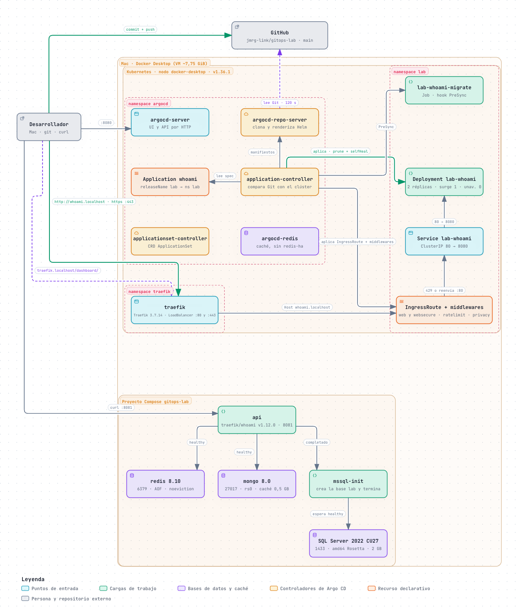

<div align="center">

# GitOps Lab

Laboratorio local del ciclo completo de un backend que se despliega con GitOps:<br/>
dependencias en Docker Compose, la API como chart de Helm y Argo CD manteniendo el clúster igual que Git.


<br/>


**[🌐 Diagramas interactivos](https://jmrg-link.github.io/gitops-lab/)** · **[jmrg.dev](https://jmrg.dev)**

[Qué es](#qué-es) · [Qué se comprueba](#qué-se-comprueba) · [Arranque rápido](#arranque-rápido) · [Diagramas](docs/diagrams/README.md) · [Documentación](#documentación) · [Autor](#autor)

</div>

## Qué es

Un backend real no termina en `npm run start`. Necesita sus bases de datos para desarrollar, un
paquete que Kubernetes sepa desplegar sin cortes, una puerta de entrada que reciba el tráfico y una
forma de que el clúster refleje siempre lo que hay en el repositorio. Este laboratorio monta las
cuatro cosas en un Mac con Docker Desktop.

La API es [traefik/whoami](https://github.com/traefik/whoami), que responde con el nombre del pod
que atiende la petición: se ve en cada momento qué versión y qué réplica contesta.

[](docs/diagrams/README.md)

| Pieza | Dónde corre | Para qué |
|---|---|---|
| `compose.yml` | Docker Compose | Redis, MongoDB y SQL Server para desarrollar contra localhost, con la API detrás |
| `charts/whoami` | Kubernetes, namespace `lab` | La API empaquetada: Job de migraciones, Deployment con rolling update y Service |
| `traefik/` | Kubernetes, namespace `traefik` | Traefik como ingress controller en `localhost:80` y `:443`, con su panel de gestión |
| `argocd/` | Kubernetes, namespace `argocd` | Argo CD instalado con su chart y la Application que despliega el chart desde este repositorio |

## Qué se comprueba

Cada pieza existe para comprobar un comportamiento concreto. La [guía 4](docs/04-que-se-comprueba.md)
tiene el comando que lo provoca y el resultado que dice si se cumple.

| # | Comportamiento | Cómo se ve |
|---|---|---|
| 1 | Las dependencias arrancan en orden | `docker compose ps -a`: bases `healthy`, `mssql-init` en `Exited (0)` y la API arriba |
| 2 | Las migraciones corren antes de la versión nueva | El Job termina antes de que arranquen los pods y su log nombra la versión |
| 3 | Desplegar no reduce la capacidad | Los eventos del Deployment: nunca menos de dos pods listos |
| 4 | Solo un commit cambia lo desplegado | Un `kubectl scale` a mano se deshace solo en segundos |
| 5 | Volver atrás es revertir un commit | `git revert` restaura la versión; `argocd app rollback` se niega |
| 6 | La puerta de entrada protege la API | 30 peticiones seguidas: unas 14 pasan y el resto recibe `429`; la API no ve la IP ni el navegador del cliente |

## Arranque rápido

```bash
cp .env.example .env                 # rellena MSSQL_SA_PASSWORD
docker compose up -d --wait          # Redis, MongoDB y SQL Server
curl localhost:8081

kubectl config use-context docker-desktop
helm repo add traefik https://traefik.github.io/charts
helm install traefik traefik/traefik --version 41.7.1 -n traefik --create-namespace \
  -f traefik/values-local.yaml --wait
helm repo add argo https://argoproj.github.io/argo-helm
helm install argocd argo/argo-cd --version 10.10.0 -n argocd --create-namespace \
  -f argocd/values-local.yaml --wait
kubectl apply -f argocd/application.yaml
```

> [!IMPORTANT]
> Hace falta Docker Desktop con Kubernetes activado (basta un nodo con Kubeadm), `helm` 4 y el CLI
> de `argocd` (`brew install helm argocd`). En Apple Silicon, activa también la emulación con
> Rosetta: SQL Server solo publica imagen x86-64.

> [!NOTE]
> La contraseña de `sa` tiene que tener al menos 8 caracteres y mezclar tres tipos entre mayúsculas,
> minúsculas, dígitos y símbolos. SQL Server la fija al crear su volumen: para cambiarla después,
> `docker compose down -v`.

Para ver la interfaz de Argo CD:

```bash
kubectl -n argocd port-forward svc/argocd-server 8080:80   # http://localhost:8080, usuario admin
argocd admin initial-password -n argocd
```

## Qué queda en marcha

| Qué | Dónde |
|---|---|
| API de Compose | <http://localhost:8081> |
| Redis | `localhost:6379` |
| MongoDB (replica set) | `mongodb://localhost:27017/lab?directConnection=true` |
| SQL Server | `localhost:1433`, usuario `sa` |
| Panel de Traefik | <http://traefik.localhost/dashboard/> (con la barra final) |
| API desplegada por Argo CD | <http://whoami.localhost/> y <https://whoami.localhost/> (certificado autofirmado) |
| Argo CD | <http://localhost:8080> con el port-forward |

## Documentación

| # | Guía | Qué cubre |
|---|---|---|
| 1 | [Docker Compose](docs/01-docker-compose.md) | Servicios, orden de arranque y por qué cada base está configurada así |
| 2 | [El chart de Helm](docs/02-chart-helm.md) | Valores, rolling update, migraciones como hook y qué hace (y qué no) un rollback |
| 3 | [GitOps con Argo CD](docs/03-argocd-gitops.md) | Instalación, la Application, cinco experimentos y la limpieza |
| 4 | [Qué se comprueba](docs/04-que-se-comprueba.md) | Los seis comportamientos, cómo provocarlos y cómo saber si se cumplen |
| 5 | [Traefik](docs/05-traefik.md) | Ingress controller, panel, rutas HTTP y HTTPS, rate limit, cabeceras de privacidad y access log |

Material visual:

- [**Diagramas interactivos**](https://jmrg-link.github.io/gitops-lab/) ([índice en el repo](docs/diagrams/README.md)): arquitectura, secuencia GitOps, arranque de Compose, ciclo de vida de la Application y rolling update.

## Estructura

```text
gitops-lab/
├── compose.yml                 Redis, MongoDB y SQL Server para desarrollo local
├── .env.example                Variables que necesita Compose
├── charts/whoami/
│   ├── Chart.yaml              Metadatos y appVersion
│   ├── values.yaml             Valores por defecto: la API pública del chart
│   └── templates/
│       ├── _helpers.tpl        Nombres y etiquetas comunes
│       ├── deployment.yaml     Rolling update, probes y apagado ordenado
│       ├── service.yaml        ClusterIP delante de los pods
│       ├── ingressroute.yaml   Rutas de Traefik por whoami.localhost, HTTP y HTTPS
│       ├── middlewares.yaml    Rate limit y cabeceras de privacidad
│       └── migrate-job.yaml    Migraciones antes de instalar o actualizar
├── traefik/
│   └── values-local.yaml       Traefik con el panel en traefik.localhost y access log
├── argocd/
│   ├── values-local.yaml       Argo CD mínimo para local
│   └── application.yaml        Despliega charts/whoami desde este repositorio
└── docs/
    ├── 01…05-*.md              Guías paso a paso
    ├── diagrams/               Diagramas interactivos autocontenidos y sus miniaturas
    └── index.html              Portada de GitHub Pages
```

Cada fichero empieza con una cabecera que explica qué hace y por qué; en `values.yaml`, cada clave
lleva su descripción en un comentario `# --`. En las plantillas, esas notas van como comentarios de
plantilla `{{- /* … */ -}}`, que no llegan al manifiesto renderizado.

Probado con Kubernetes 1.36.1, Helm 4.3.1, el chart `argo/argo-cd` 10.10.0 (Argo CD 3.5.4), el chart
`traefik/traefik` 41.7.1 (Traefik 3.7.14) y Docker
Engine 29.8.

## Limpieza

```bash
kubectl delete -f argocd/application.yaml   # antes que Argo CD: su finalizer lo necesita
helm uninstall argocd -n argocd
helm uninstall traefik -n traefik
kubectl delete namespace argocd lab traefik
docker compose down -v
```

## Autor

<table>
  <tr>
    <td>
      <a href="https://github.com/jmrg-link"></a>
    </td>
    <td>
      <strong>Jesús María Rico González</strong><br/>
      Senior Full Stack Developer · Node.js, NestJS y arquitecturas limpias<br/>
      <a href="https://jmrg.dev">jmrg.dev</a> ·
      <a href="https://github.com/jmrg-link">GitHub</a> ·
      <a href="https://www.linkedin.com/in/jesus-maria-rico-gonzalez/">LinkedIn</a>
    </td>
  </tr>
</table>

## Licencia

[MIT](LICENSE) © 2026 Jesús María Rico González
