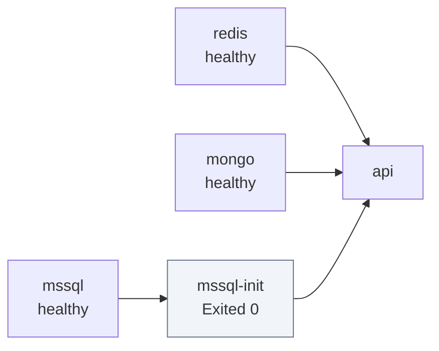
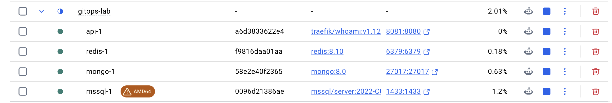

# 1. Dependencias locales con Docker Compose

El backend necesita tres piezas para trabajar en local: Redis para las colas, MongoDB y SQL Server.
`compose.yml` las levanta con la misma configuración que importa en producción, para que lo que
funciona aquí no sorprenda después.

## Arranque

```bash
cp .env.example .env              # y rellena MSSQL_SA_PASSWORD
docker compose up -d --wait
docker compose ps -a
curl localhost:8081
```

`--wait` no vuelve hasta que todos los servicios con healthcheck están sanos. Si algo falla, el
comando termina con error y `docker compose ps -a` dice cuál.

## Los servicios

| Servicio | Imagen | Puerto | Para qué |
|---|---|---|---|
| `redis` | `redis:8.10` | 6379 | Colas de trabajos (BullMQ) |
| `mongo` | `mongo:8.0` | 27017 | Documentos: sesiones, telemetría, datos que cambian de forma |
| `mssql` | `mcr.microsoft.com/mssql/server:2022-CU27-GDR1-ubuntu-22.04` | 1433 | Relacional: cuentas, licencias, facturación |
| `mssql-init` | la misma que `mssql` | — | Crea la base `lab` y termina |
| `api` | `traefik/whoami:v1.12.0` | 8081 | Sustituto de la API; en un proyecto real sería `build: .` |



La API arranca solo cuando las tres bases están sanas y `mssql-init` ha terminado bien
(`service_completed_successfully`). Por eso `docker compose ps -a` muestra `mssql-init` como
`Exited (0)`: es lo esperado, no un fallo.



En Docker Desktop, SQL Server aparece con la marca `AMD64`: corre emulado con Rosetta.

## Decisiones que conviene conocer

**Redis con `noeviction` y AOF.** Con cualquier otra política, Redis expulsa claves cuando se llena,
y para una cola eso significa trabajos que desaparecen sin error. AOF guarda cada escritura en disco
para que un reinicio no pierda lo que había en cola.

**MongoDB como replica set de un nodo.** Las transacciones multidocumento solo existen con replica
set. El healthcheck inicia el replica set la primera vez y falla hasta que el nodo es primario, así
que los primeros segundos del log están llenos de avisos que desaparecen solos. Conecta con
`mongodb://localhost:27017/lab?directConnection=true`.

**MongoDB con `--quiet` y healthcheck espaciado.** Sin `--quiet`, cada comprobación de salud deja
varias líneas de conexiones abiertas y cerradas. El healthcheck comprueba cada 2 segundos mientras
arranca y cada 30 después. Con los dos cambios, el log pasa de unas 280 líneas por minuto a menos de
20.

**SQL Server emulado en Apple Silicon.** Microsoft solo publica imagen x86-64, así que en un Mac con
chip Apple corre con Rosetta. Hay que activar *Use Rosetta for x86_64/amd64 emulation* en Docker
Desktop. Microsoft no da soporte a esa emulación; para desarrollo funciona.

**La contraseña de `sa` se fija una sola vez.** SQL Server la guarda al crear su volumen. Si cambias
`MSSQL_SA_PASSWORD` después, el healthcheck usará la nueva y SQL Server seguirá esperando la vieja:
el servicio no llegará a estar sano. Para cambiarla, borra el volumen con `docker compose down -v`.

**Memoria limitada.** La caché de MongoDB se queda en 512 MB y SQL Server en 2 GB, el mínimo que
admite. Así queda sitio para Kubernetes y Argo CD en la misma máquina virtual de Docker.

**`$$` en los comandos.** En `compose.yml`, `$$MSSQL_SA_PASSWORD` escapa la variable para que la
expanda el shell del contenedor y no Compose al leer el fichero.

## Parar y limpiar

```bash
docker compose down        # para los contenedores y conserva los datos
docker compose down -v     # además borra los volúmenes
```

El Mongo de este Compose escucha en `localhost:27017`, así que cualquier aplicación del equipo que
apunte ahí guarda sus datos en el mismo volumen; la API NestJS del clúster usa la base `nest-k8s`.
Antes de un `down -v`, mira qué bases hay con
`docker compose exec -T mongo mongosh --quiet --eval 'db.getMongo().getDBNames()'`.
