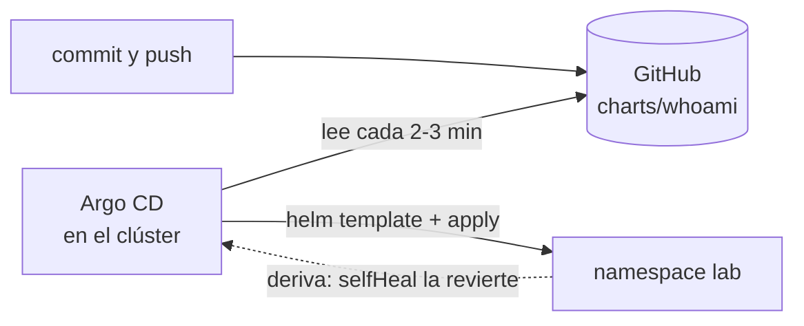

# 3. GitOps con Argo CD

Con GitOps, el repositorio es la fuente de verdad del clúster. Nadie aplica cambios a mano: se hace un
commit, y Argo CD, que vive dentro del clúster, compara Git con lo desplegado y lo iguala.



## Instalar Argo CD

Argo CD se instala con su chart oficial, igual que en un clúster real.

```bash
helm repo add argo https://argoproj.github.io/argo-helm
helm install argocd argo/argo-cd --version 10.10.0 -n argocd --create-namespace \
  -f argocd/values-local.yaml --wait
kubectl -n argocd get pods
```

El chart 10.10.0 instala Argo CD 3.5.4 y sus tres CRD: `Application`, `AppProject` y
`ApplicationSet`. `values-local.yaml` sirve la interfaz por HTTP y quita el SSO (Dex) y las
notificaciones para ahorrar memoria. No sirve para producción, donde van TLS, SSO y alta
disponibilidad.

## Entrar

```bash
kubectl -n argocd port-forward svc/argocd-server 8080:80
argocd admin initial-password -n argocd
argocd login localhost:8080 --plaintext --username admin
```

La interfaz queda en http://localhost:8080 con el usuario `admin`. La contraseña inicial vive en el
secreto `argocd-initial-admin-secret`; fuera de un laboratorio se cambia con
`argocd account update-password` y se borra ese secreto.

## La Application

```bash
kubectl apply -f argocd/application.yaml
argocd app get whoami
```

`argocd/application.yaml` le dice a Argo CD qué desplegar y cómo mantenerlo:

| Campo | Valor | Efecto |
|---|---|---|
| `source.path` | `charts/whoami` | El chart de este repositorio, rama `main` |
| `helm.releaseName` | `lab` | Los mismos nombres de recursos que `helm install lab` |
| `destination.namespace` | `lab` | Con `CreateNamespace=true`, lo crea si no existe |
| `syncPolicy.automated.prune` | `true` | Borra del clúster lo que desaparece de Git |
| `syncPolicy.automated.selfHeal` | `true` | Deshace los cambios hechos a mano en el clúster |
| `finalizers` | `resources-finalizer…` | Borrar la Application borra también lo desplegado |

La Application tiene dos estados independientes: **sincronización** (`Synced` u `OutOfSync`, Git
frente al clúster) y **salud** (`Healthy`, `Progressing`, `Degraded`, `Missing`).

Si haces un fork, cambia `repoURL`. Un repositorio privado hay que registrarlo antes con
`argocd repo add`.

## Experimentos

**1. Un cambio en Git.** Sube `replicaCount` a 3 en `charts/whoami/values.yaml`, haz commit y push.
Argo CD revisa el repositorio cada 120 segundos, más un margen aleatorio de hasta 60. Para no esperar:

```bash
argocd app get whoami --refresh
```

**2. Deriva.** Cambia el clúster a mano:

```bash
kubectl -n lab scale deployment lab-whoami --replicas=1
```

La Application pasa a `OutOfSync` y, con `selfHeal`, vuelve a lo que dice Git en segundos.

**3. Una versión nueva.** Pon `image.tag: v1.12.0` en `values.yaml` y haz push. Argo CD traduce los
hooks de Helm a fases propias: el Job de migraciones corre como `PreSync` y después llega el rolling
update. Se sigue con `kubectl -n lab get pods -w` o en la interfaz.

**4. Rollback.** Volver atrás es revertir el commit:

```bash
git revert HEAD --no-edit && git push
```

`argocd app rollback whoami` se niega mientras la sincronización automática esté activa, porque Git
volvería a imponer su versión en la siguiente pasada.

**5. Helm no lo ve.** `helm list -A` solo muestra `argocd`. Argo CD usa Helm para renderizar las
plantillas, pero aplica los manifiestos él mismo y no crea ninguna release.

## Cómo llega una versión nueva en un equipo real

El pipeline de CI construye la imagen, la publica en el registro y cambia `image.tag` en el
repositorio de GitOps con un commit o una pull request. Argo CD hace el resto. El pipeline nunca
necesita credenciales del clúster, y el historial de Git es el historial de despliegues.

## Limpiar

```bash
kubectl delete -f argocd/application.yaml
helm uninstall argocd -n argocd
kubectl delete namespace argocd lab
```

Borra la Application antes que Argo CD: su finalizer necesita el controlador para eliminar lo
desplegado, y sin él la Application se queda atascada. Los CRD siguen en el clúster después del
`uninstall`, porque el chart los instala con `crds.keep: true`. *Reset cluster*, en la vista de
Kubernetes de Docker Desktop, lo deja todo como al principio.
