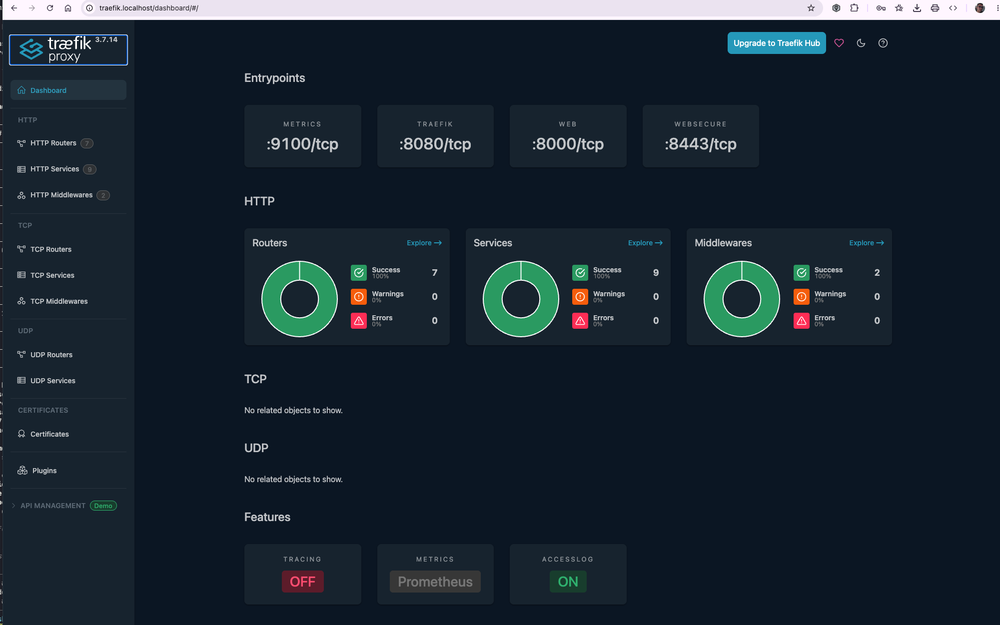
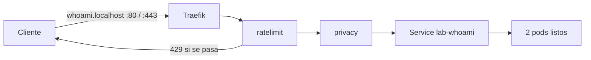
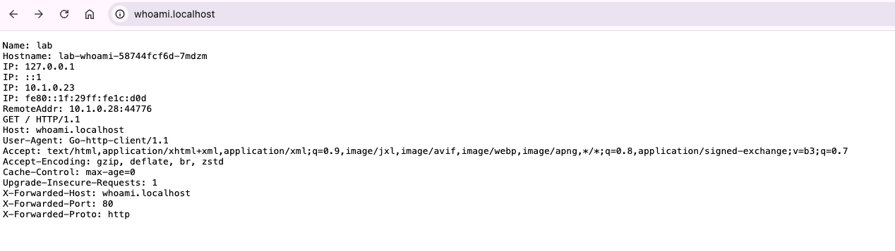

# 5. Traefik como puerta de entrada al clúster

Traefik es el ingress controller del laboratorio: recibe las peticiones que llegan a `localhost:80`
y `localhost:443`, decide por el nombre de host a qué Service van y aplica por el camino los
middlewares de la ruta. Su panel enseña en directo qué rutas, servicios y middlewares hay.

## Instalar

```bash
helm repo add traefik https://traefik.github.io/charts
helm install traefik traefik/traefik --version 41.7.1 -n traefik --create-namespace \
  -f traefik/values-local.yaml --wait
kubectl -n traefik get pods,svc
```

El chart 41.7.1 instala Traefik 3.7.14 y sus CRD (`IngressRoute`, `Middleware`, etc.). Traefik se
instala antes que la Application de Argo CD, porque el chart de la API usa esos CRD.

El Service de Traefik es de tipo `LoadBalancer`, y Docker Desktop lo publica en `localhost`:

| Entrypoint | Puerto en el pod | Puerto en localhost | Uso |
|---|---|---|---|
| `web` | 8000 | 80 | HTTP |
| `websecure` | 8443 | 443 | HTTPS con el certificado por defecto de Traefik |
| `traefik` | 8080 | — | API y panel internos, sin publicar |
| `metrics` | 9100 | — | Métricas de Prometheus |

Cualquier nombre `*.localhost` resuelve a `127.0.0.1`, así que no hace falta tocar `/etc/hosts`.

## URLs

| URL | Qué es |
|---|---|
| <http://traefik.localhost/dashboard/> | Panel de Traefik. La barra final es obligatoria: sin ella responde 404 |
| <http://whoami.localhost/> | La API por HTTP |
| <https://whoami.localhost/> | La API por HTTPS. El certificado es autofirmado: el navegador avisa y `curl` necesita `-k` |
| `http://traefik.localhost/api/http/routers` | Las rutas en JSON, lo mismo que enseña el panel |

El panel no tiene autenticación y enseña toda la configuración de enrutado: sirve para local, no
para producción.



## La ruta de la API

El chart de `charts/whoami` genera un `IngressRoute` por entrypoint de `ingress.entryPoints`. Una
ruta con `tls` solo atiende peticiones TLS, por eso la de `websecure` va aparte de la de `web`.



| Middleware | Qué hace | Valor por defecto |
|---|---|---|
| `lab-whoami-ratelimit` | Limita las peticiones por IP de origen; por encima responde `429 Too Many Requests` sin llegar a la API | 5 por segundo de media, ráfaga de 10 |
| `lab-whoami-privacy` | Borra de la petición las cabeceras que identifican al cliente y añade cabeceras de seguridad a la respuesta | Ver `ingress.stripRequestHeaders` |

`privacy` borra `User-Agent`, `Accept-Language`, las `Sec-Ch-Ua*` y `Sec-Fetch-*`, `X-Forwarded-For`,
`X-Real-Ip` y `X-Forwarded-Server`. El `User-Agent: Go-http-client/1.1` que aparece después lo pone
el propio proxy de Traefik al reenviar. En la respuesta añade `X-Frame-Options: DENY`,
`X-Content-Type-Options: nosniff` y `Referrer-Policy: no-referrer`.



whoami sigue mostrando las IP del pod. La dirección `fe80::…` es de enlace local y se deriva de la
MAC de la interfaz virtual del pod, que genera Kubernetes; no es la del equipo anfitrión.

## Comprobarlo

```bash
curl -s http://whoami.localhost/                       # sin X-Forwarded-For ni User-Agent del cliente
curl -sk -o /dev/null -w '%{http_code}\n' https://whoami.localhost/
curl -sI http://whoami.localhost/ | grep -i -E 'x-frame|x-content|referrer'
for i in $(seq 1 30); do curl -s -o /dev/null -w '%{http_code}\n' http://whoami.localhost/; done | sort | uniq -c
```

La última línea manda 30 peticiones seguidas: pasan unas 14 (la ráfaga más lo que se recarga
mientras tanto) y el resto recibe `429`.

## Access log

`traefik/values-local.yaml` activa el access log. Cada petición deja una línea en la salida del pod
con el código de respuesta y el router que la atendió:

```bash
kubectl -n traefik logs deploy/traefik -f
```

## API Management

El panel muestra una sección *API Management* marcada como *Demo* y un botón *Upgrade to Traefik
Hub*. Es una función de Traefik Hub, el producto comercial, y necesita su licencia: el chart la
activa con `hub.apimanagement.enabled` y un Secret con el token. Con el Traefik de código abierto
que usa el laboratorio, los middlewares cubren la parte de pasarela: límite de peticiones,
cabeceras, autenticación (`basicAuth`, `forwardAuth`), reintentos y circuit breaker.

## Limpiar

```bash
helm uninstall traefik -n traefik
kubectl delete namespace traefik
```

Si se desinstala Traefik con la Application de Argo CD activa, la sincronización falla porque el
chart de la API usa sus CRD. Desactiva antes la ruta con `ingress.enabled: false` en `values.yaml`.
