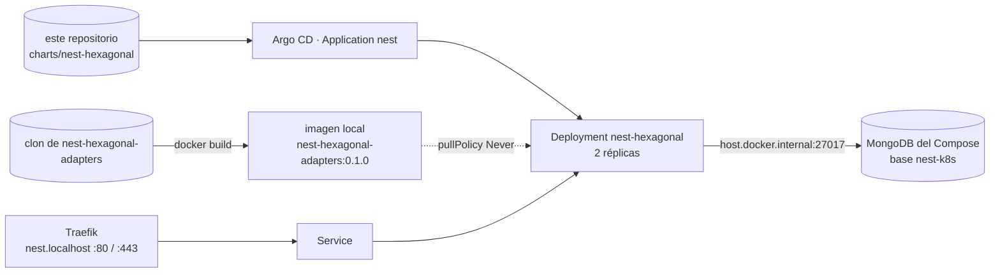

# 6. Una API real: NestJS con MongoDB

whoami sirve para ver el enrutado, pero no tiene estado. Esta guía despliega con el mismo flujo una
API real, [nest-hexagonal-adapters](https://github.com/jmrg-link/nest-hexagonal-adapters): usuarios
y pedidos por REST y GraphQL, con autenticación JWT y MongoDB como persistencia.

El código de la API no se copia a este repositorio. Aquí solo viven lo necesario para desplegarla:
el Dockerfile, el chart y la Application.



## 1. Construir la imagen

```bash
git clone https://github.com/jmrg-link/nest-hexagonal-adapters ../nest-hexagonal-adapters
docker build -f apps/nest-hexagonal/Dockerfile -t nest-hexagonal-adapters:0.1.0 ../nest-hexagonal-adapters
```

El contexto de build es el clon de la API; el Dockerfile y sus exclusiones están en
`apps/nest-hexagonal/`. Docker usa `Dockerfile.dockerignore`, el fichero de exclusiones con el mismo
nombre que el Dockerfile, en lugar del `.dockerignore` del contexto, así que el clon no necesita
cambios.

| Etapa | Qué hace |
|---|---|
| `build` | `pnpm install --frozen-lockfile` con el pnpm fijado en `packageManager` (el `postinstall` genera el cliente de Prisma) y `pnpm build` a `dist/` |
| final | Solo `dist/`, las dependencias de producción y `package.json`; corre como el usuario `node`, sin root |

Quedan fuera de la imagen los ficheros ocultos (variables de entorno locales incluidas),
`node_modules`, `dist`, los tests, la documentación y el cliente de Prisma generado en el equipo.

En Docker Desktop, Kubernetes usa el mismo motor Docker, así que la imagen recién construida está
disponible para el clúster sin publicarla en un registro. Por eso el chart usa
`imagePullPolicy: Never`: si la imagen no existe en local, el pod queda en `ErrImageNeverPull` en
lugar de intentar descargarla.

## 2. El secreto

La API exige `JWT_SECRET` (mínimo 32 caracteres) y no arranca sin él. No va en Git, porque este
repositorio es público: se crea a mano en el clúster.

```bash
kubectl create namespace nest
kubectl -n nest create secret generic nest-hexagonal-secrets \
  --from-literal=JWT_SECRET="$(openssl rand -hex 32)"
```

El Deployment lo lee con `secretKeyRef`; el resto de variables están en `values.yaml` porque no son
secretas.

| Variable | Valor | Por qué |
|---|---|---|
| `NODE_ENV` | `development` | Deja activos GraphiQL en `/graphql`, Swagger UI en `/docs` y la introspección para explorar la API; con `production` se desactivan |
| `DB_DRIVER` | `mongoose` | Persistencia en MongoDB |
| `MONGO_URI` | `mongodb://host.docker.internal:27017/nest-k8s?directConnection=true` | El Mongo del Compose, visto desde el clúster |
| `CORS_ORIGINS` | `https://nest.localhost` | Origen permitido para el navegador |
| `JWT_SECRET` | Secret `nest-hexagonal-secrets` | Firma de los tokens |

`host.docker.internal` es el nombre con el que Docker Desktop expone el equipo anfitrión dentro de
los contenedores y los pods. `directConnection=true` hace falta porque el replica set del Compose se
anuncia como `localhost:27017`, que dentro del pod no es el Mongo.

La base es `nest-k8s` y no la `orders` que trae la API por defecto, para que los datos del clúster no
se mezclen con los de una API arrancada fuera de él contra el mismo Mongo.

## 3. Desplegar

```bash
kubectl apply -f argocd/application-nest.yaml
argocd app get nest
kubectl -n nest get pods,svc,ingressroute
```

La Application `nest` sigue la misma política que la de whoami: sincronización automática, `prune` y
`selfHeal`, con `releaseName: nest-hexagonal` para que los recursos se llamen `nest-hexagonal`.

La API no tiene ruta de salud, así que las tres probes comprueban que el puerto 3000 acepta
conexiones. La API cierra sus conexiones al recibir SIGTERM (`enableShutdownHooks`), y el `preStop`
de 5 segundos da tiempo a que Traefik deje de enviarle tráfico antes.

## 4. Probarla

```bash
curl -s -X POST https://nest.localhost/graphql -k \
  -H 'content-type: application/json' -d '{"query":"{__typename}"}'
```

Responde `{"data":{"__typename":"Query"}}` por `http://` y por `https://`. La raíz `/` responde 404:
la API no tiene ruta ahí.

Desde el navegador, <https://nest.localhost/graphql> abre GraphiQL y <https://nest.localhost/docs>
abre Swagger UI. Una petición `GET` a `/graphql` que no pida HTML la rechaza Apollo con un error de
CSRF: solo acepta las que llevan `content-type: application/json` o la cabecera
`apollo-require-preflight`.

El ciclo completo de autenticación, por HTTPS:

```bash
EMAIL="prueba-$(date +%s)@example.com"; PASS="Lab-$(openssl rand -hex 8)"
curl -sk -X POST https://nest.localhost/auth/register -H 'content-type: application/json' \
  -d "{\"email\":\"$EMAIL\",\"name\":\"Prueba\",\"password\":\"$PASS\"}"
TOKEN=$(curl -sk -X POST https://nest.localhost/auth/login -H 'content-type: application/json' \
  -d "{\"email\":\"$EMAIL\",\"password\":\"$PASS\"}" | jq -r .accessToken)
curl -sk https://nest.localhost/auth/me -H "authorization: Bearer $TOKEN"
docker compose exec -T mongo mongosh --quiet nest-k8s --eval "db.users.countDocuments({email: '$EMAIL'})"
```

**Se cumple si** el registro responde `201`, el login devuelve un token, `/auth/me` devuelve el
email con el rol `customer` y Mongo cuenta un documento.

## Actualizar la API

Con un cambio en el código de la API, se reconstruye la imagen con un tag nuevo y se cambia
`image.tag` en `charts/nest-hexagonal/values.yaml`. El commit dispara el rolling update. En un
equipo real la imagen se publicaría en un registro desde el pipeline de CI y `pullPolicy` volvería a
`IfNotPresent`.

## Cuidado al limpiar

El Mongo del Compose lo comparten todas las aplicaciones que se conecten a `localhost:27017`.
`docker compose down -v` borra su volumen, con la base `nest-k8s` y cualquier otra que haya creado
otra aplicación. Antes de lanzarlo, comprueba qué bases hay:

```bash
docker compose exec -T mongo mongosh --quiet --eval 'db.getMongo().getDBNames()'
```

Para quitar solo la API:

```bash
kubectl delete -f argocd/application-nest.yaml
kubectl delete namespace nest
```
