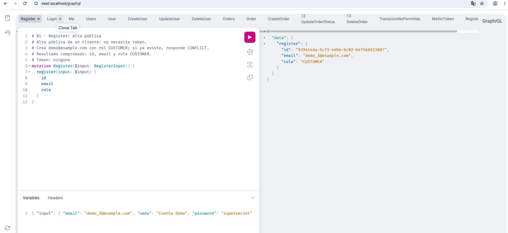
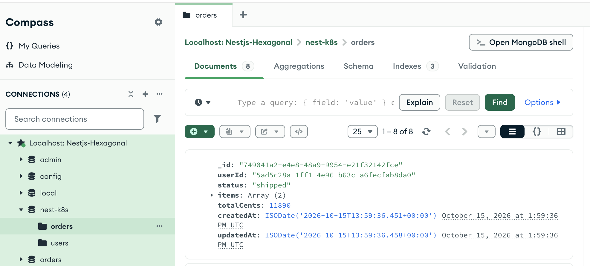
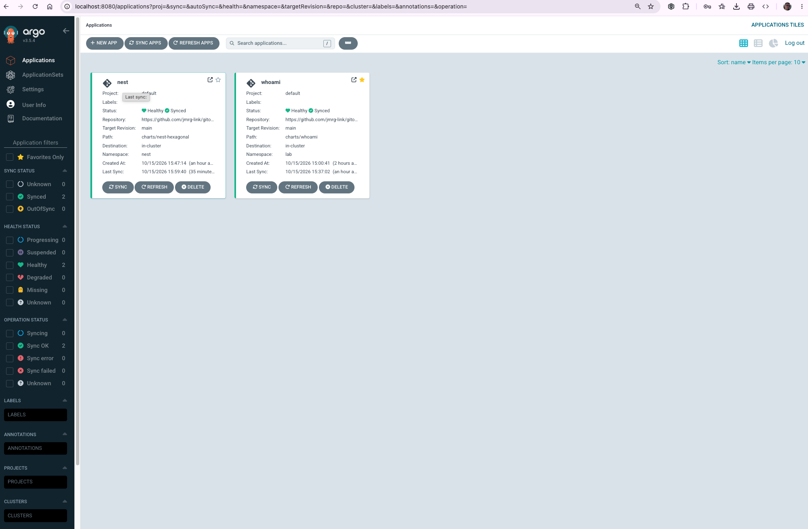
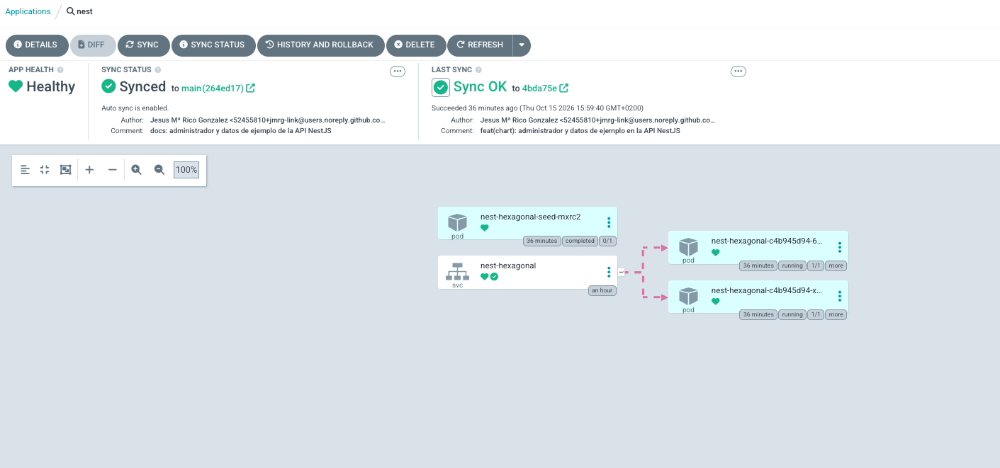
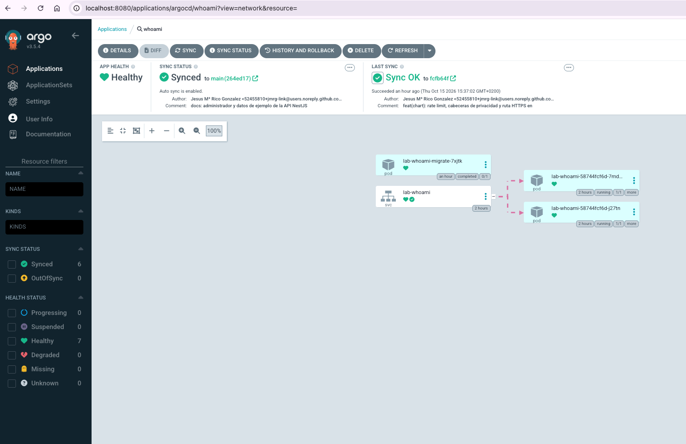

# Capturas

El laboratorio en marcha: lo que se ve en cada interfaz con todo desplegado.

[← Documentación](../../README.md#documentación) · [Diagramas →](../diagrams/README.md)

## 1. GraphiQL de la API NestJS

`http://nest.localhost/graphql`, con una pestaña por operación. Cada una empieza con comentarios que
explican qué hace, qué token necesita y de dónde sale cada id. La mutation `register` crea un
cliente y devuelve su id y su rol. Ver la [guía 6](../06-api-nestjs.md).

## 2. MongoDB en Compass

La base `nest-k8s` del Mongo del Compose, con las colecciones `orders` y `users`. Los 8 pedidos son
los del seed; este está en `shipped`, y es el que usa la operación de transición no permitida.

## 3. Argo CD: las dos Applications

`whoami` y `nest`, las dos `Synced` y `Healthy`, leyendo de la rama `main` de este repositorio.

## 4. Argo CD: la Application nest

Sincronizada con el último commit. El pod del Job del seed aparece como `completed` (es el hook
PostSync) junto al Service y las dos réplicas de la API.

## 5. Argo CD: la Application whoami

El Job de migraciones `completed` (hook PreSync), el Service y las dos réplicas.

## 6. Docker Desktop: el proyecto Compose

Los contenedores de `gitops-lab` con sus puertos publicados. SQL Server lleva la marca `AMD64`
porque corre emulado con Rosetta en Apple Silicon.

## 7. whoami a través de Traefik

`http://whoami.localhost/`. Las cabeceras que identifican al cliente ya no llegan: el `User-Agent`
es el del proxy (`Go-http-client/1.1`) y no hay `X-Forwarded-For` ni `X-Real-Ip`, porque el
middleware `privacy` los borra. Ver la [guía 5](../05-traefik.md).

## 8. Panel de Traefik

`http://traefik.localhost/dashboard/`: 7 routers, 9 servicios y los 2 middlewares, todos sin
errores, con el access log activado.

