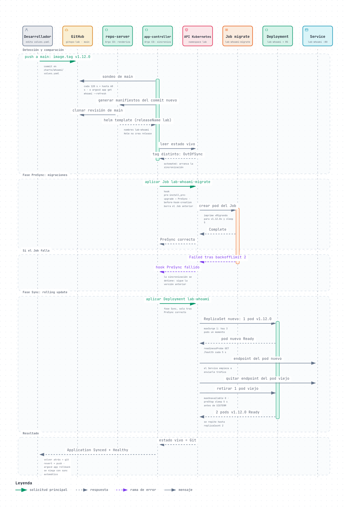
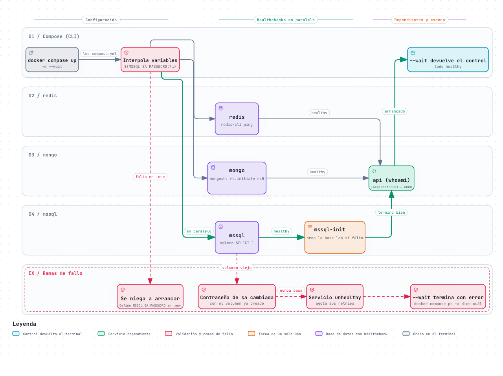
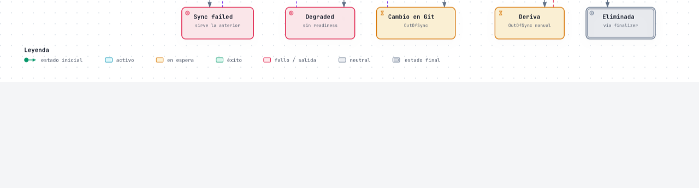
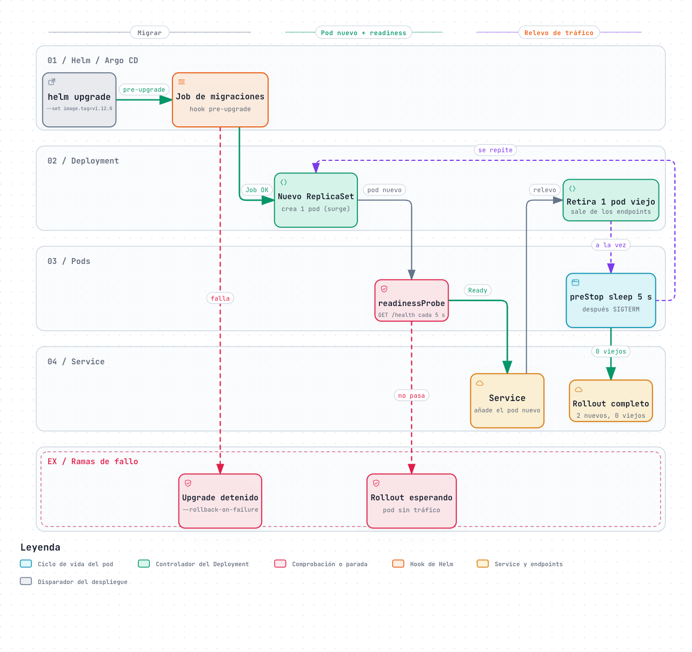

# Diagramas

Cinco diagramas interactivos que explican cómo está montado el laboratorio: qué piezas hay y dónde
corren, cómo arranca Compose, cómo llega un commit al clúster, en qué estados pasa la Application de
Argo CD y cómo se sustituyen los pods sin cortar el servicio.

**[Ver los diagramas en la web →](https://jmrg-link.github.io/gitops-lab/)**

Cada miniatura abre su diagrama publicado en GitHub Pages. Los HTML de esta carpeta son
autocontenidos: también funcionan descargados, sin dependencias externas.

> [!TIP]
> En el HTML hay zoom, búsqueda, tema claro y oscuro, modo **Ruta** para seguir un camino, modo
> **Lente** para aislar un tipo de componente y exportación a PNG o SVG. Cada diagrama termina con
> una tarjeta «Dónde está en el código» con las rutas `archivo:línea`.

**Orden de lectura:** [01](#01--arquitectura-del-laboratorio) para el conjunto →
[03](#03--arranque-de-compose) para las dependencias locales →
[02](#02--secuencia-gitops-de-un-commit-a-los-pods-nuevos) para el despliegue →
[05](#05--rolling-update-sin-pérdida-de-servicio) para el detalle del relevo de pods →
[04](#04--ciclo-de-vida-de-la-application) para los estados de Argo CD.

## 01 · Arquitectura del laboratorio

El Mac con Docker Desktop, el proyecto de Compose con sus tres bases de datos, el clúster de
Kubernetes con los namespaces `traefik`, `argocd` y `lab`, y el repositorio de GitHub del que Argo CD
lee el chart. Traefik recibe el tráfico de `localhost:80` y `:443` y lo pasa por el rate limit y las
cabeceras de privacidad antes de llegar a la API.

## 02 · Secuencia GitOps: de un commit a los pods nuevos

Qué pasa desde que se cambia `image.tag` en Git hasta que la Application vuelve a `Synced` y
`Healthy`: sondeo, renderizado con Helm, Job de migraciones en PreSync y rolling update en Sync, con
la rama en la que la migración falla.

## 03 · Arranque de Compose

`docker compose up -d --wait` paso a paso: variables obligatorias, healthchecks en paralelo,
`mssql-init` como tarea de un solo uso y la API esperando a que todo esté listo. Incluye por qué
puede quedarse SQL Server sin arrancar si cambia la contraseña.

## 04 · Ciclo de vida de la Application

Los estados por los que pasa la Application de Argo CD: la primera sincronización, un cambio en
Git, la deriva que deshace `selfHeal`, los fallos de migración o de readiness y el borrado con su
finalizer.

## 05 · Rolling update sin pérdida de servicio

Con dos réplicas, `maxSurge: 1` y `maxUnavailable: 0`: el pod nuevo tiene que pasar la readiness
antes de que se retire uno viejo, y el `preStop` da tiempo a que el Service deje de enviarle tráfico.

---

[← Documentación](../../README.md#documentación) · [Qué se comprueba →](../04-que-se-comprueba.md)
